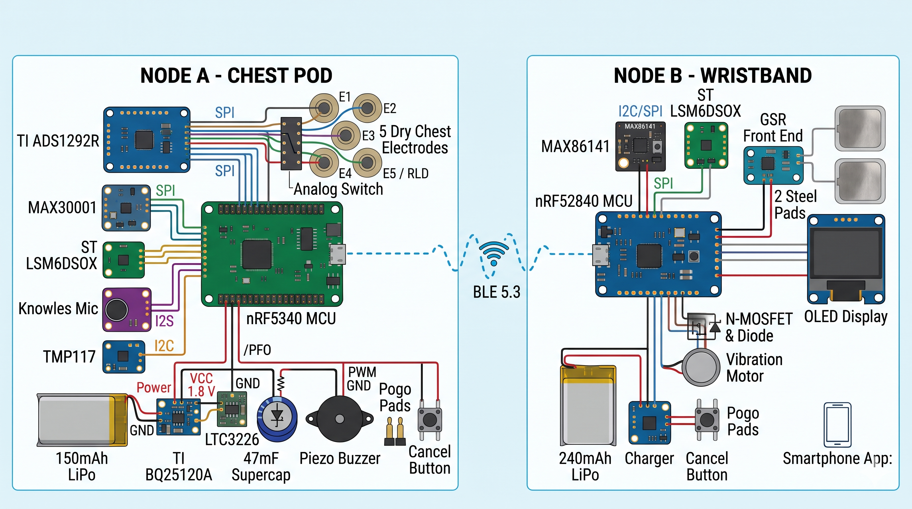
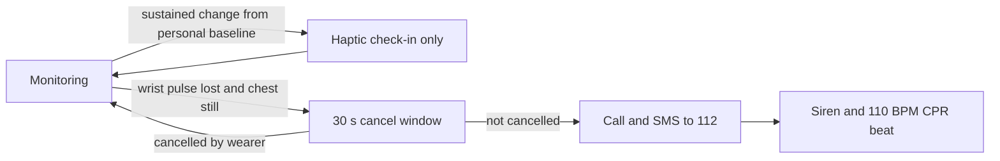

# Autonomous Sternal Sentry

A student concept and simulation study of a two-node wearable for cardiac emergency alerting.
Prepared for the **MakeInSilicon 2026 Ideathon**, Track 1 (Smart Innovation in AI with Embedded Platforms: Smart Healthcare Systems).

> **Project status: concept and simulation only.**
> No hardware has been built. This is not a medical device, it has not been clinically tested, and nothing in this repository shows that it detects or predicts a heart attack or cardiac arrest.

## Overview

The idea is a chest-worn **Sentry Pod** (ECG, chest vibration, optical pulse) and a wrist-worn **PulseBand** (wrist pulse, motion), linked over Bluetooth Low Energy to a phone app. The two nodes cross-check each other before any emergency call is made.



*Proposed hardware. Part choices shown here are design intent; some are still open.*

### Alert logic (as simulated)



## What has been tested

Each result carries an evidence label: **Simulated** (our own signals in a Verilog simulator) or **Replayed** (our logic run on a public recording).

| Area | Result | Evidence |
|---|---|---|
| Alarm logic | Self-checking testbenches pass 22/22, 20/20 and 35/35; deliberately broken versions fail | Simulated |
| Heartbeat detector, clean ECG | 99.95 % mean sensitivity, 99.64 % mean positive predictivity (18 people, 30 min each) | Replayed (NSRDB) |
| Heartbeat detector, heavy noise | Falls to 57-62 % sensitivity and 45-48 % positive predictivity at -6 dB | Replayed (NSTDB) |
| False countdown starts | 13 in 17.9 h of daily-life data (7 test people, all from 2 of them) | Replayed (PPG-DaLiA) |
| Heart-rate drift check | Caught only 8 of 178 labelled ischemic ST episodes at 1.07 false check-ins per day | Replayed (LTSTDB) |
| Ventricular fibrillation | The "no heartbeat" ECG rule fired within 5 min in only 5 of 10 onsets | Replayed (SDDB) |
| Tiny neural network | No added value shown over simple ST rules on unseen patients | Replayed (EDB) |
| Per-person calibration | Built into training, mean AUROC rose from 0.64 to about 0.80 (descriptive; the pre-set pass rule was still not met) | Replayed (EDB) |
| 8-bit network in Verilog | Bit-exact on 2,064 of 2,064 vectors, 44,962 cycles per beat | Simulated |

Full methods, failures and limits are in the [reports](docs/reports/README.md).

### Key limitations

- No public recording combines our three sensor types during a heart attack or arrest, so early detection **cannot** be shown with existing data. Arrest remains simulated.
- The heart-rate drift check misses most labelled ischemic episodes.
- Real ventricular fibrillation can fool the ECG beat detector.
- ST-episode labels were assigned using an amplitude criterion, so ST-based results are partly circular.
- No power, battery life or on-chip timing has been measured.

## Repository layout

```
.
├── docs/
│   ├── design/        Architecture, form-factor analysis, team decision log
│   ├── research/      12-phase literature review, takeaways and product translations
│   ├── reports/       Simulation, real-data and edge-AI reports
│   └── competition/   Abstract, poster content, pitch guide, hardware booklet
├── simulation/
│   ├── rtl/           Verilog design of both nodes
│   ├── model/         Behavioural models: patient, sensor chips, radio, phone
│   ├── tb/            Self-checking testbenches
│   ├── rtl_edge/      Stand-alone 8-bit neural network block and its test
│   ├── py/            Dataset replay, analysis and model training
│   ├── configs/       Frozen experiment settings
│   ├── splits/        Patient-wise train and test splits
│   └── results/       Logs, tables and figures
└── data/              How to obtain the public datasets (data is not committed)
```

## Getting started

Requirements: Python 3 and, for the Verilog tests, AMD Vivado (tested with 2025.2).

```bash
pip install -r requirements.txt
```

Run the Verilog regression from a Windows Command Prompt:

```bat
C:\AMDDesignTools\2025.2\Vivado\settings64.bat
cd simulation
run_vivado.bat
```

Expected: 22, 20 and 35 checks pass; mutation A fails 16 checks and mutation B fails 1.

- Simulator guide: [simulation/README.md](simulation/README.md)
- Replaying public recordings: [simulation/REAL_DATA.md](simulation/REAL_DATA.md)
- Dataset sources and licences: [data/README.md](data/README.md)

## Documentation

Start at the [documentation index](docs/README.md). The design and research documents describe **intent and background reading**; where they differ from a test report, the report is correct.

<!-- Team section: add member names, roles, college and registration ID here. -->

## License

Code and original documentation are released under the [MIT License](LICENSE). Public datasets, cited publications and the organiser's presentation template remain under their own terms.
