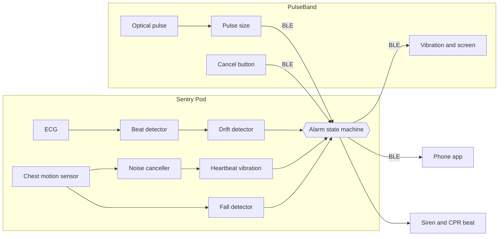
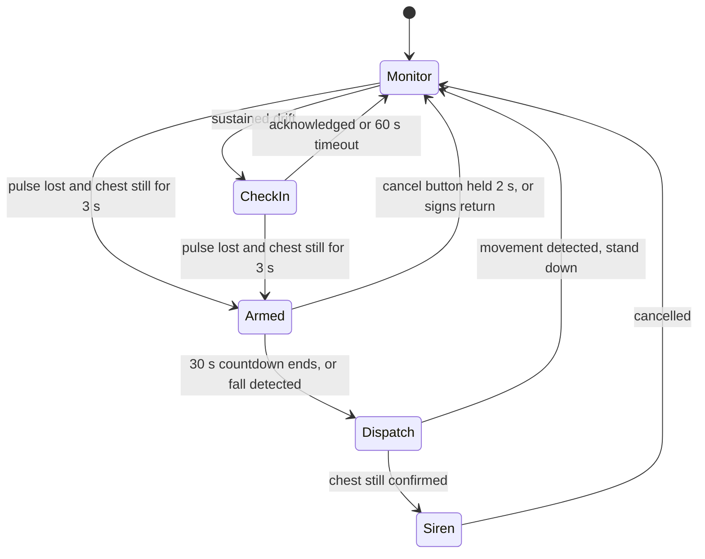
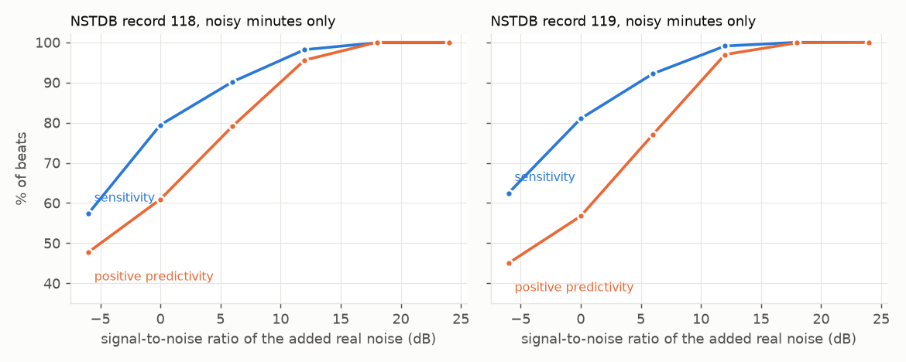
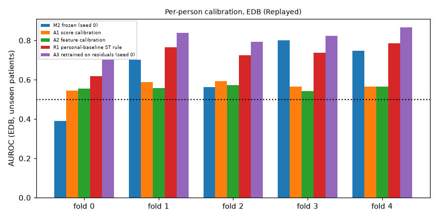

<div align="center">

# Autonomous Sternal Sentry

**A two-node wearable concept that cross-checks the chest and the wrist before calling for help**


[Idea](#the-idea) · [How it works](#how-it-works) · [Results](#results) · [Quick start](#quick-start) · [Roadmap](#roadmap) · [Documentation](docs/README.md)

</div>

> [!NOTE]
> A student research prototype at the concept and simulation stage, with hardware in the design phase. It is not a medical device. Detection of heart attack or cardiac arrest has not been demonstrated or clinically tested.

Prepared for the **MakeInSilicon 2026 Ideathon**, Track 1: Smart Innovation in AI with Embedded Platforms (Smart Healthcare Systems).

## The problem

In a sudden cardiac arrest the wearer cannot call for help. A single wrist sensor is also easy to fool: a loose strap or a moving arm can look like a lost pulse. An alarm that is often wrong gets switched off.

We asked a narrow engineering question: **can two body locations check each other well enough to raise an alarm automatically, while staying quiet in ordinary life?**

## The idea

| Node | Worn on | Controller (proposed) | Senses and does |
|---|---|---|---|
| **Sentry Pod** | Breastbone | nRF5340 | ECG, chest vibration and motion, breathing (bio-impedance), temperature, sound; runs the alarm logic and siren |
| **PulseBand** | Wrist | nRF52840 | Optical pulse, skin conductance, vibration motor, countdown screen, cancel button |
| **Phone app** | Pocket | Any smartphone | Receives the alert over Bluetooth Low Energy, then calls and texts 112 with location |

Two rules shape the design:

1. **A slow change never calls anyone.** Drift from the wearer's own baseline only produces a gentle check-in on the wrist.
2. **An emergency needs agreement.** The wrist pulse must be lost *and* the chest must show no heartbeat vibration, followed by a cancel window.

## How it works

### Signal chain



If the wristband goes silent, the pod falls back to checking for missing ECG beats.

### Alarm states



After a detected fall the cancel button is locked out. Times and thresholds are initial values to be tuned on hardware; the 3 s hold may become 10 s. Source: [`pod_alarm_fsm.sv`](simulation/rtl/pod_alarm_fsm.sv).

## Results

Results are either **Simulated** (our own signals in a Verilog simulator) or **Replayed** (our logic run on public recordings of real people).

### Demonstrated so far

| Capability | Result | Evidence |
|---|---|---|
| Alarm logic | 22/22, 20/20 and 35/35 self-checking tests pass, and the tests catch deliberately broken versions | Simulated |
| Heartbeat detection on clean ECG | 99.95 % sensitivity, 99.64 % positive predictivity (18 people, 30 min each) | Replayed, NSRDB |
| False-alarm reduction | An ECG check or a 10 s hold removed all 13 false countdown starts seen in 17.9 h of daily life (from 2 of 7 test people) | Replayed, PPG-DaLiA |
| 8-bit neural network in Verilog | Matches the software model bit for bit on 2,064 of 2,064 inputs, 44,962 cycles per heartbeat | Simulated |

Design note: an ECG check would also hold back the alarm if electrical activity continued without a pulse, so it needs further safeguards.

### Engineering findings that shape the next design

| Area | Measured today | Planned response | Evidence |
|---|---|---|---|
| Noise robustness | 57-62 % sensitivity and 45-48 % positive predictivity in the heaviest noise (-6 dB) | Better motion rejection and signal-quality checks | Replayed, NSTDB |
| Ventricular fibrillation | The ECG-only "no heartbeat" rule fired within 5 minutes in 5 of 10 onsets | Do not rely on ECG beats alone | Replayed, SDDB |
| Early drift warning | Heart rate flagged 8 of 178 labelled ischemic episodes at 1.07 false check-ins per day | Add signals beyond heart rate | Replayed, LTSTDB |
| Learned model | Did not yet outperform simple ST rules on unseen patients | Build personalisation into training, with simple rules as the benchmark | Replayed, EDB |

### Key insights

**1. Accurate on clean signals, with noise as the next target.** Detection stays strong at 18 dB or better; the work ahead is below 12 dB.



**2. Heart rate alone is not enough.** Catching more ischemic episodes costs many more false check-ins, which is why the design looks to additional signals.

<p align="center">
  
</p>

**3. Personalisation is a promising direction.** Retraining on each beat's difference from that person's recent normal raised mean area under the curve from 0.64 to about 0.80 on unseen patients (purple against blue). Beating a simple personal-baseline rule at a strict false-alarm setting is the next milestone.



**Rigorous evaluation.** Every reported model result splits data by patient. The same network scored **0.95** when one person's heartbeats appeared in both training and testing, and **0.39** on the first group of unseen patients, so a mixed split would badly overstate performance.

Full methods and numbers: [report index](docs/reports/README.md).

## Scope of the current work

- Demonstrating early detection needs recordings that combine these sensors around cardiac events. No public dataset provides them, so arrest scenarios are simulated.
- Testbench sensor signals are modelled by us, with assumed noise levels.
- ST-episode labels were assigned by an amplitude criterion, so ST-based results are partly circular.
- Power use, battery life, radio behaviour and on-chip timing will be measured on hardware.
- The neural network block is verified on its own; connecting it to the alarm logic is future work.

## Roadmap

| Stage | Meaning | Work |
|---|---|---|
| **Now** | Done in simulation or on public recordings | Alarm logic, dataset replays, patient-wise model tests, 8-bit hardware check |
| **Next** | Build and measure | A no-heartbeat check that does not rely on ECG alone, both nodes on real hardware, measured sensor noise and battery life, a drift signal beyond heart rate |
| **Future** | Needs patients, hospitals and approvals | Recording chest and wrist data with a clinical partner, training on it, a supervised study, regulatory review |

## Quick start

**Requirements:** Python 3, and AMD Vivado for the Verilog tests (tested with 2025.2 on Windows).

```bash
git clone https://github.com/Headhunte-121/Ideathon-Research.git
```

```bash
cd Ideathon-Research
```

```bash
pip install -r requirements.txt
```

Run the full Verilog regression from a Windows Command Prompt:

```bat
C:\AMDDesignTools\2025.2\Vivado\settings64.bat
cd simulation
run_vivado.bat
```

Expected: 22, 20 and 35 checks pass. The two deliberately broken builds report 16 failures and 1 failure.

To replay public recordings, first [get the datasets](data/README.md), then follow the [replay guide](simulation/REAL_DATA.md).

## Repository structure

```
.
├── docs/
│   ├── design/        Architecture and design decisions
│   ├── reports/       Test reports (the source of truth)
│   └── competition/   Abstract and poster content
├── simulation/
│   ├── rtl/           Verilog design of both nodes
│   ├── model/         Simulated patient, sensor chips, radio and phone
│   ├── tb/            Self-checking testbenches
│   ├── rtl_edge/      8-bit neural network block
│   ├── py/            Dataset replay and model training
│   ├── configs/       Settings frozen before testing
│   ├── splits/        Patient-wise train and test splits
│   └── results/       Logs, tables and figures
└── data/              Dataset sources (recordings are not committed)
```

## Documentation

| Read this | For |
|---|---|
| [Report index](docs/reports/README.md) | What was tested and what the numbers do not show |
| [Simulation guide](simulation/README.md) | Design blocks and testbenches |
| [System design](docs/design/DESIGN.md) | Architecture, design decisions and open questions |

Design and competition documents set out the **design vision**, including planned features. For measured results, the reports are the reference.

<!-- Team section: add member names, roles, college and registration ID here. -->

## Acknowledgements

Recordings come from [PhysioNet](https://physionet.org) (Goldberger et al., *Circulation* 101(23):e215-e220, 2000) and the [PPG-DaLiA](https://archive.ics.uci.edu/dataset/495/ppg+dalia) dataset. Each dataset keeps its own licence and citation requirements; see [data/README.md](data/README.md).

## License

Code and original documentation are released under the [MIT License](LICENSE). Datasets and cited publications remain under their own terms.
