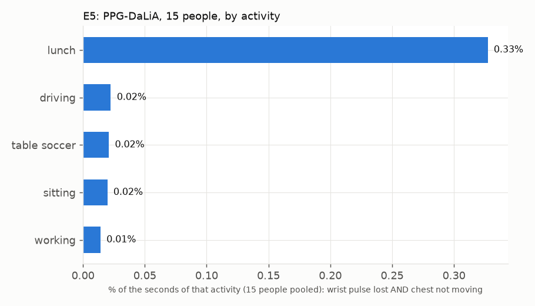

Method: `py/real_ppg_dalia.py` and `py/e5_episodes.py` (no Verilog; pure Python on the recordings). Wrist PPG (Empatica E4, 64 Hz) is band-passed 0.5-4 Hz; "pulse size" is its per-second peak-to-peak. "Pulse lost" = pulse size below 15 % of **that person's own median while sitting**. "Chest moving" = per-second standard deviation of the chest accelerometer magnitude (RespiBAN, 700 Hz) above 5 x that person's own sitting median (sitting medians are 3-6 mg). Activity labels come from the dataset. Thresholds (15 %, 5x) are the script's defaults, **Assumed**, not tuned.

| Activity | People | Seconds | Pulse lost % (pooled) | Chest moving % | Lost AND chest still % (pooled) | Worst person: lost AND still % |
|---|---|---|---|---|---|---|
| sitting | 15 | 9141 | 0.0 | 1.7 | 0.02 | 0.3 (person 8) |
| working | 14 | 17001 | 0.0 | 6.7 | 0.01 | 0.1 (person 3) |
| lunch | 14 | 27099 | 0.5 | 27.3 | 0.33 | 3.9 (person 8) |
| driving | 15 | 13683 | 0.2 | 84.5 | 0.02 | 0.4 (person 8) |
| table soccer | 15 | 4625 | 0.1 | 82.2 | 0.02 | 0.3 (person 8) |
| stairs | 15 | 6484 | 0.0 | 99.7 | 0.00 | 0.0 (person 1) |
| walking | 14 | 9387 | 0.0 | 98.4 | 0.00 | 0.0 (person 1) |
| cycling | 15 | 6954 | 0.0 | 100.0 | 0.00 | 0.0 (person 1) |

**Episodes that would start the Pod's cancel window.** The Pod arms when pulse loss and a still chest are held for 3 s. Counting runs of "pulse lost AND chest not moving" in these living people: **65 runs in 36.0 person-hours, 13 of them 3 s or longer** (0.36 per person-hour), affecting **2 of 15 people**; the longest lasted 8 s. 11 of the 13 are person 8 during the lunch segment (all within about 2 minutes), 2 are in activity-transition periods.

*Replayed on public recordings (PPG-DaLiA, 15 people, 36.0 person-hours).*

What it shows: while sitting, working or driving, the wrist pulse is almost never "lost" by this definition (0.0-0.2 % of seconds); during lunch it happens more (pooled 0.3 % lost and still, person 8 reaches 3.9 %), which fits a wrist resting at an angle or a hand in use while the chest is quiet. So wrist pulse loss with a quiet chest **does occur in living people**, and in 13 cases for at least 3 s.
**What it does NOT show / caveats:** (1) The Pod's chest condition is "no heartbeat vibration in the chest", **not** "no chest motion"; DaLiA's chest accelerometer is not a seismocardiogram sensor, so the full arming condition cannot be tested on it. E4 shows living supine people always keep their chest vibration above the threshold, which would stop these episodes from arming, but E4 people were lying on a bed. This link is **not tested** for sitting/lunch. (2) Peak-to-peak cannot tell a pulse from motion artefact, so the "pulse lost" figures during walking, cycling and stairs (about 0 %) mean "something large was on the wrist", not "a good pulse was present"; only the still activities are informative. (3) The cancel window (30 s) and the phone link are downstream of these episodes and were not exercised here. (4) 15 healthy adults, 2 h each, one wrist PPG device.
