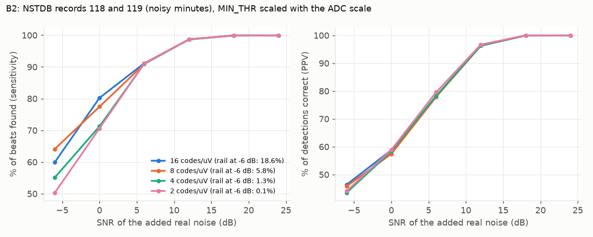
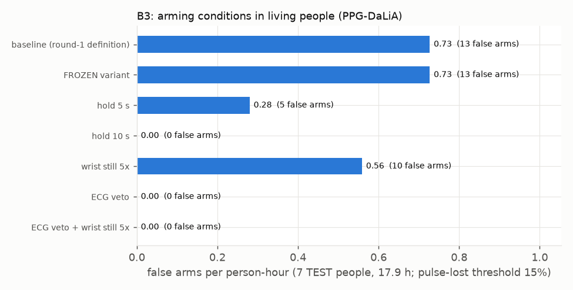
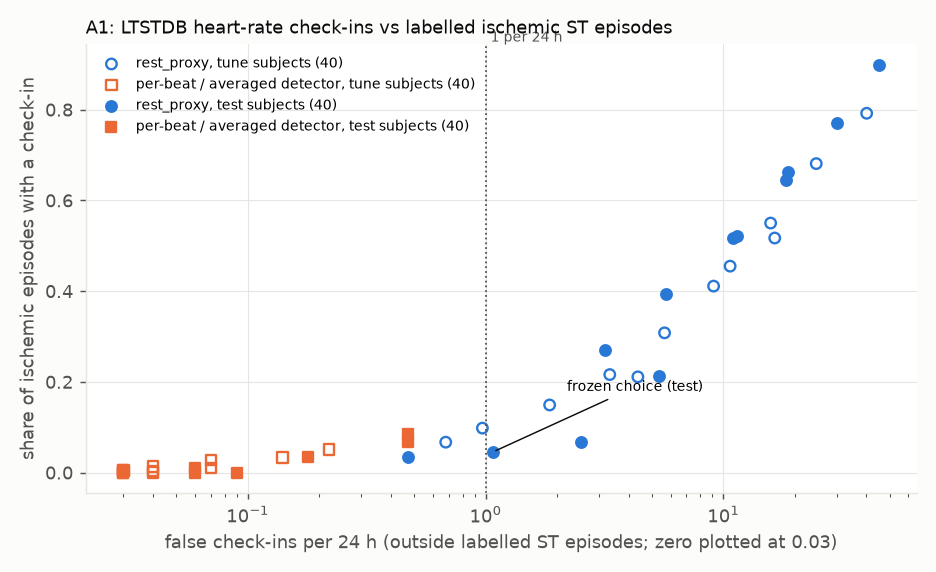
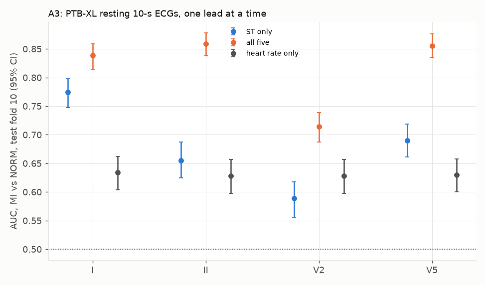
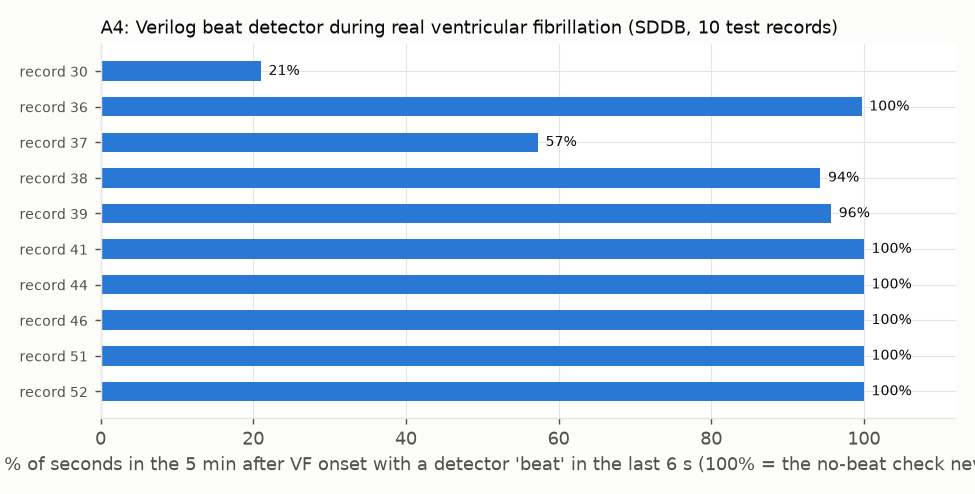

# Real-data report, round 2: heart-attack / ischemia / arrest datasets and the tweaks

Built by `py/build_report2.py` from the CSVs in `results/` (re-run it after any experiment). Date of runs: 6 Nov 2026. Round 1: `results/REAL_DATA_REPORT.md`. Simulator: Vivado xsim 2025.2.

**Evidence labels used everywhere:** **Replayed** = ran the Verilog (or its Python copy, said where) on a public recording. **Calculated** = arithmetic on replayed numbers. **Cited** = from a datasheet or paper named in place. **Simulated** = something made up or added to a real recording (noise, a step in heart rate, the scenario testbench). **Assumed** = a value without a source.

## 0. Summary for a first-year student (one page)

**What we did.** We took recordings of real people from public databases and ran our alarm logic on them. Round 2 added databases that contain real heart trouble: ST-segment changes that doctors marked as ischemia (the heart muscle short of blood), real heart attacks on 12-lead ECGs, and real ventricular fibrillation (VF, the heart quivering instead of pumping, the typical sudden-arrest rhythm). **Nothing here shows that our device senses a heart attack or an arrest early.** No public recording has our sensors (chest ECG + chest vibration + wrist pulse) during a heart attack. What the data can show is where the logic breaks.

**What worked.**
- Living people in daily life sometimes had the wrist pulse lost while the chest was quiet (13 false starts of the 30-second countdown in 7 people over 17.9 hours; all from two people). Requiring that the chest ECG shows no heartbeats for 3 seconds removed all 13 at no time cost, and holding the condition for 10 seconds instead of 3 also removed them (it makes dispatch 7 seconds slower). *(B3, Replayed.)*
- The beat detector's loss in heavy noise is **not** caused by my ADC scaling: shrinking the scale 8-fold removed the clipping and did not help. *(B2, Replayed.)*
- A drift check that watches heart rate against the person's own recent resting level caught 4.5% of marked ischemic episodes with about 1 false alarm per day on 40 people it was not tuned on. *(A1, Replayed.)*

**What did not work, and matters more.**
- **The "no heartbeat" check on the ECG fails in real fibrillation.** The Verilog beat detector keeps counting "beats" in the fibrillation waves (60 to 136 per minute in 8 of 10 test records), so the Pod's 6-second no-beat rule never fired within 5 minutes in half of the real VF onsets, and never in the 5 real ventricular-tachycardia episodes tested. An ECG-beat veto on arming must be described as "can be fooled by VF". *(A4, Replayed on the Verilog detector.)*
- **The heart-rate drift check is almost blind**, and the way to make it see more produces many false alarms: catching 90% of the ischemic episodes cost about 45 false alarms per day, and catching 4.5% cost about 1 per day. Most ischemic episodes in this database follow heart-rate rises, which flatters a heart-rate detector, and it still did not work well. Using only resting beats did not fix it on the daily-life data (0 of 7 people caught). *(A1, B4.)*
- **ST level alone is a weak heart-attack sign** on resting 10-second 12-lead ECGs (area under the curve 0.59 to 0.77 depending on the lead; 0.5 would be a coin flip); adding T-wave, Q-wave and heart-rate features helped (up to 0.86). This is a diagnostic ECG on a bed, not a wearable. *(A3, Replayed in Python.)*
- **An adaptive "chest still" threshold looks like a fix in the simulator but is unsafe on real people.** In the simulator a threshold that follows the sensor noise (set at 1.75 times a running low percentile of the chest energy) kept the arrest scenario working up to 1000 micro-g of noise, where the fixed threshold fails from 650. When the same rule is emulated on the real resting recordings it would call 95% or more of living seconds "still" at the setting that works in the simulator. The settings that are safe on real data behave exactly like the fixed threshold in the simulator. Nothing here fixes the problem, and the chip's real noise figure could not be checked (datasheet unreachable). *(B5, B6.)*

**Bottom line for the team.** The honest poster claim is "alarm logic simulated and replayed on public recordings, with its failure modes measured". The strongest new findings are failures, and they are useful: they say exactly what the final design must add (a second condition beyond the ECG, a longer hold, a real noise figure for the chest sensor).

## 1. What the poster may say, and must not say

### 1.1 May say (exact wording, with label)

<<POSTERMAY>>

### 1.2 Must not say

| Do not write | Why |
|---|---|
| "validated", "clinically tested", "proven" | Nothing here is a clinical test of the device or of the combined sensor set |
| "detects heart attacks / ischemia / arrest", any sensitivity or specificity for them, any lead time as a capability | No recording has our sensors during a heart attack; the A1 "lead times" are check-ins that follow heart-rate changes, not predictions |
| "ECG-beat check catches ventricular fibrillation" | A4: the detector keeps finding beats during real VF (half the onsets never triggered the no-beat rule in 5 minutes) |
| "heart-rate drift detects ischemia" | A1: it caught 4.5% of episodes at about 1 false alarm per day; catching more costs tens of false alarms per day |
| "ST level detects a heart attack" | A3: ST alone is weak; it is a resting diagnostic ECG, not a wearable or sternal lead |
| "adaptive threshold fixes the sensor-noise problem" | B5: not shown; the chip's real noise figure is unverified |
| the ECG-veto's zero false arms as a result without the PEA caveat | The veto would also block the countdown in pulseless electrical activity (PEA); DaLiA cannot test that |
| any number from the tune sets as a result | Only test-set numbers are results; tune-set numbers are in separate tables |

## 2. Rules followed, splits and frozen files

Seeded tune/test splits by person (or record) were written **before** the experiments and are in `splits/`: `dalia_split.json` (PPG-DaLiA, 8 tune / 7 test), `a4_split.json` (SDDB + CUDB, stratified by whether a record has VF/VT), `a1_split.json` (LTSTDB, by subject: 40 tune / 40 test, stratified by whether the subject has an ischemic episode). PTB-XL uses the dataset's own folds (train 1-8, validate 9, test 10). Chosen configurations were saved to `configs/*_frozen.json` and committed locally (not pushed) **before** the test run: `b3_frozen`, `b4_frozen`, `a4_frozen`, `a1_frozen`, `a3_frozen` (commits `4e7c09a`, `abf5f6c`, `672b09a`, `b12e732`, `1d4a287` and the A1 split commit). Each test stage checks the split file's SHA-256 against the frozen file and ran once. Exceptions are marked "re-used" where they occur. B2 (two records), B5 (model sweep) and B1 need no split and say so.

## 3. Results

### B1. The E5 chart/table mismatch

**Cause.** The round-1 chart showed lunch 32.7% and sitting 2.0%; the table showed 0.33% and 0.02%. Both used the same quantity, "percent of that activity's seconds with the wrist pulse lost and the chest not moving, pooled over people" (seconds-weighted). The chart code multiplied a column that was already a percentage by 100 again, so every bar was 100 times too large; the denominators were the same. **Fixed:** `py/make_charts.py` now computes the seconds-weighted mean without the extra factor and the axis says "% of the seconds of that activity (15 people pooled)". Figure: `results/fig_e5_pulse_lost_and_still_by_activity.png`. Round 1's text and tables were correct; only the chart was wrong. *Label: Replayed (Python).*

### B2. Beat detector in noise at smaller ADC scales (NSTDB records 118 and 119)

**Method.** The unchanged `rtl/ecg_beat_detector.sv`, replayed through a testbench copy in `rtl_variants/` whose `MIN_THR` is a parameter. SNR 24, 18, 12, 6, 0, -6 dB; scales 16, 8, 4 and 2 codes/uV; for scales below 16 the `MIN_THR` floor was both scaled in proportion (750, 375, 187) and left unscaled (1500). Noisy minutes only, two records, no tune/test split needed. **Data:** NSTDB, records 118 and 119 (mean of the two shown). *Label: Replayed (Verilog).*

<<B2>>

**What it shows.** The share of samples on the 16-bit rail at -6 dB falls from 18.6% (scale 16) to 5.8%, 1.3% and 0.1%, yet sensitivity does not improve: at -6 dB it is 59.9, 64.1, 55.1 and 50.3% and at 0 dB 80.2, 77.4, 71.2 and 70.8%. PPV barely moves (46.4, 45.8, 43.4, 44.0% at -6 dB). Scaling or not scaling `MIN_THR` changes the counts only at scale 2 and only slightly, because the floor is not what limits the detector in noise. So the loss in heavy noise belongs to the detector (its threshold follows the noise bursts), not to my scaling. The round-1 hint that clipping might be partly responsible is refuted (also found in round 1's tweak 3). **Does NOT show:** a better detector; the numbers on only two records; any effect on the Pod's alarm (the alarm does not depend on this detector). **Allowed wording:** "Beat detector misses about 20% (0 dB) to 40% (-6 dB) of beats in heavy real noise and 40-55% of its detections are wrong; not a scaling artefact. Replayed on public recordings (NSTDB, 2 records)."

### B3. Arming conditions on PPG-DaLiA

**Method.** `py/b3_features.py`, `py/b3_ecg_rtl.py`, `py/b3_arming.py`. False arm = at least H seconds in a row in which, for a living person, the wrist pulse is lost (pulse size below 15% of that person's own sitting median, sensitivity check at 10% and 25%) AND the chest is not moving (at most 5x the sitting median) [AND the wrist is still] [AND no ECG veto]. ECG veto = a beat of the unchanged Verilog detector at 30-180 bpm in the last 3 s (chest ECG 700 Hz to 250 Hz, 16 codes/uV, 0.5 Hz AC coupling, at most 0.002% of samples on the ADC rail in any person). Cost = added dispatch delay (H-3 s). **Data:** PPG-DaLiA, 15 people, 36 h; split `splits/dalia_split.json` (tune S2 S4 S6 S9 S12 S13 S14 S15; test S1 S3 S5 S7 S8 S10 S11). *Label: Replayed (Verilog detector for the ECG; Python for the rest).*

**Tune result.** The 8 tune people had **zero** false arms under every configuration (all of the false arms in this dataset come from two people, S8 and S5, who both fall in the test group). Tuning could therefore choose nothing, and the frozen configuration is the plain baseline (`configs/b3_frozen.json`).

**Test result (7 people, 17.9 person-hours).** Baseline = frozen. The five variants below were pre-specified from round 1 and are **not** selected on test; round 1 had already examined S5 and S8, so this is **not an independent test of the fix**.

<<B3>>

False arms by activity at baseline (pulse-lost threshold 15%): lunch 11, activity transitions 2 (all from S8 and S5).

**What it shows.** An ECG-beat veto removes every false arm at all three pulse-loss thresholds (baseline: 7, 13 and 41 false arms in 1, 2 and 6 people at 10, 15 and 25%). A 10 s hold also removes them at 10% and 15% but not at 25% (2 remain); a 5 s hold leaves 5; "wrist still" alone leaves 10. The ECG veto costs no dispatch time; the 10 s hold costs 7 s. **Does NOT show:** whether the veto blocks arrests with electrical activity but no pulse (PEA), which DaLiA cannot test, and which the poster must state; behaviour during sleep or exercise beyond what DaLiA covers; independence (see above). **Allowed wording:** "In 17.9 person-hours of living people (7 people, test group), wrist pulse loss with a quiet chest held for 3 s occurred 13 times (2 people); an ECG-beat veto removed all 13 and a 10 s hold removed them at the default threshold (7 s slower). The veto would also suppress pulseless electrical activity. Replayed on public recordings (PPG-DaLiA); not an independent test."

### B4. Rest-only drift test on PPG-DaLiA

**Method.** `py/b4_rest_drift.py`. Heart rate per beat from the Verilog beat detector's output on the chest ECG. Rest = chest motion at most 5x the person's sitting median. The same detector logic (`py/drift_model.py`, the checked Python copy of `baseline_drift_detector.sv`), the same K, ALL beats vs REST beats only; learning on the first 1024 beats of each stream (about 13 min). A step of +10, +15, +25% (**Simulated**) is added to every rest beat after 60% of the rest stream; false check-ins counted without the step; detection counted only for people not already flagged at the step. K chosen on tune: 4.5 (`configs/b4_frozen.json`). *Label: Replayed + Simulated step.*

<<B4>>

**What it shows.** On the 7 test people both streams had zero false check-ins at K = 4.5 and **caught none of the injected steps (0 of 7 at +10, +15 and +25%)**: gating on rest did not make this detector see anything. On the tune people the lower K values caught 1 of 8 and produced a false alarm. **Why:** only about 2 h per person; the learning window (13 min) and the spread of heart rate at rest (round 1: sitting and working differ by about 29%) leave a 25% step within the learned spread. **Does NOT show:** that a 24 h learning period behaves the same; the resting-only idea in its better form (a baseline for the same context, see round-1 tweaks). **Allowed wording:** "Feeding only resting beats to the unchanged drift detector did not let it detect +10 to +25% heart-rate steps in 7 people (about 2 h each). Replayed + simulated step."

### A1. Long-Term ST Database: heart-rate check-ins vs labelled ischemic episodes

**Method.** `py/a1_ltstdb.py`. Heart rate per beat from the database's own manually corrected beat annotations (the beat detector is not in the loop). **Annotation criterion: the `.stc` set (ST deviation of at least 100 uV for at least 60 s).** From the annotation codes: `(stN ... stN)` = ischemic episode (the only positive class, 567 episodes in 86 records), `(rtstN ... rtstN)` = heart-rate-related episode (91; reported separately, not counted as ischemia), `sstN` axis-shift marks (2388; counted, and excluded like the other labelled episodes from the false-alarm time). Variants: `rtl` (K = 3.0/3.8/4.5, learning 2^13 beats), `avg60`, `avg120` (causal moving average first), and `rest_proxy` (**Assumed proxy, no motion channel**: 60 s mean heart rate more than X% above the rolling 5th percentile of the previous 10 min for T minutes; X in 15/20/25/30, T in 2/5/10). An episode counts as caught if a check-in fires between 30 min before its onset and its end. False check-ins are counted only outside every labelled ST episode plus 30 min, and normalised to 24 h of that episode-free time. Subjects (not records) were split: 40 tune / 40 test. Selection rule (fixed in advance): at most 1 false check-in per 24 h on tune, then highest ischemic-episode sensitivity. *Label: Replayed (heart rate from annotations; Python copy of the drift detector, checked against the Verilog in round 1).*

**Tune set (43 records, 389 ischemic episodes, 986 h): all 21 settings** (selected setting marked):

<<A1TUNE>>

**Test set (43 records, 178 ischemic episodes, 1006 h), frozen setting vs the untuned baseline:**

<<A1TEST>>

The figure shows **every** pre-defined setting on the tune subjects (open markers) and on the test subjects (filled); it is descriptive only, no choice was made from the test points. <<A1HINT>>

**What it shows.** The per-beat detector as built catches 0.6% of the ischemic episodes (1 of 178) with no false alarms; the frozen rest-proxy setting catches 4.5% (8 of 178) with 1.07 false check-ins per 24 h (36 in 809 episode-free hours; 10 of 43 records had at least one) and, for the 8 it caught, a median check-in 9.5 min before onset. Raising sensitivity costs false alarms steeply (see the figure): about 90% of episodes with about 45 false check-ins per 24 h. **Important:** most ischemic episodes in this database follow heart-rate rises, which flatters a heart-rate-based detector, and it still performs poorly; the 9.5 min "lead" is a check-in on a heart-rate change near an episode, not a prediction. **Does NOT show:** early detection of ischemia, any use of chest vibration or wrist pulse, or behaviour of a wearable (Holter ECG, 3-lead recorders, patients on ambulatory monitoring). **Allowed wording:** "A heart-rate drift check (tuned on 40 patients, tested on 40 other patients, LTSTDB, 43 records) caught 8 of 178 ischemic ST episodes at 1.07 false check-ins per 24 h; catching most episodes costs tens of false check-ins per day. Most episodes in this database follow heart-rate rises. Replayed on public recordings."

### A2. European ST-T Database: confirmation of the frozen A1 setting

**Method.** `py/a2_edb.py`. The frozen A1 setting is run unchanged, plus the untuned baseline, on EDB (90 two-hour excerpts, 79 subjects). **Overlap check:** ten LTSTDB headers state that an excerpt of the recording is in EDB (records e0103, e0104, e0105, e0113, e0125, e0127, e0129, e0162, e0603, e0604); with the same-subject EDB records listed in the EDB description (e0123, e0124, e0126, e0133, e0163) **15 records were excluded; 75 were used.** EDB positive class = ST-segment change (`(STn+/-` ... `STn+/-)`, 184 episodes), T-wave changes (230) reported separately; EDB does not label ischemic origin. *Label: Replayed.*

<<A2>>

**What it shows.** The frozen setting caught 7 of 184 ST-change episodes (3.8%) and 11 of 230 T-wave episodes with 1 false check-in; the A1 result (4.5%, about 1 false per 24 h) is therefore not contradicted, but the false rate rests on **28.7 episode-free hours** and a single event, so it is very uncertain. The untuned baseline's 20 false check-ins per 24 h come from a mismatch: it needs 2^13 beats (about 2 h) to learn, which is the whole excerpt; it is only "live" in the few records with more beats. **Does NOT show:** independent confirmation of sensitivity; only about 29 hours of non-episode time exist in these excerpts, which were chosen to be full of ST changes. **Allowed wording:** "The A1 setting, unchanged, caught 3.8% of ST-change episodes in 75 two-hour recordings from a second database (15 overlapping records excluded); the false-alarm rate is too uncertain to quote."

### A3. PTB-XL: how much does ST alone carry?

**Method.** `py/a3_ptbxl.py`, **Python only, not RTL.** 10-second resting diagnostic 12-lead ECGs at 100 Hz. MI = any diagnostic SCP code in the MI superclass (5469 records); NORM = all diagnostic codes in NORM (9069). Beats from the Python port of the Verilog detector; per lead (I, II, V2, V5) features from the median beat: ST level (an **Assumed** stand-in for J+60 ms: R+110 ms relative to the PR level), ST slope, T amplitude, Q depth, heart rate. Logistic regression (C chosen on fold 9, threshold = Youden point on fold 9), trained on folds 1-8, **frozen** (`configs/a3_frozen.json`), tested once on fold 10 (1462 records, 550 MI). 95% intervals: bootstrap (AUC), Wilson (sensitivity, specificity). *Label: Replayed (Python).*

<<A3>>

**What it shows.** ST alone separates MI from normal only weakly (AUC 0.59 to 0.77; best lead I at 0.774); with T amplitude, Q depth and heart rate the AUC is 0.71 to 0.86 (lead II 0.859, V5 0.855), so ST carries part but not most of the signal. Heart rate alone already gives 0.63. **Does NOT show:** early warning (these are resting diagnostic ECGs on patients who already have an MI diagnosis or none), a wearable, or a sternal lead. **Allowed wording:** "On 10-second resting 12-lead ECGs (PTB-XL, test fold 10, 1462 ECGs), ST level and slope alone give an AUC of 0.59 to 0.77 for MI vs normal depending on the lead; five simple features give 0.71 to 0.86. Not early warning, not wearable. Replayed (Python)."

### A4. Real arrests: SDDB (VF onsets) and CUDB (VT/VF excerpts), ECG only

**Method.** `py/a4_windows_rtl.py`, `py/a4_beats_py.py`, `py/a4_analysis.py`. **Beats:** the unchanged Verilog beat detector on a window from 10 min before to 5 min after each SDDB VF onset and on every CUDB record; the Python port of the same detector (`py/beat_model.py`, scores within 0.12 percentage points of the Verilog on clean ECG; **not** bit-exact) on the whole SDDB records (about 440 million samples, too long for the simulator) for the false-flag rate. Invalid ADC samples (NaN) in these records are forward-filled and counted (`results/a4_beats_py_*.txt`). **Onsets:** SDDB header `vfon` read as elapsed time from the record start (checked on five records: the detector's beat count and the ECG amplitude change at that time; record 52 is unclear); CUDB from the rhythm annotations (`(VT`, `(VF`). **Pod logic:** `pod_node.sv` flags pulse loss from the ECG when no detector beat has been seen for `NOBEAT_S` = 6 s (only used when the wrist band is silent); no stand-alone copy of the whole Pod was needed. **Proposed flags** (tuned on tune records only; selection rule: at most 1 false flag per hour on tune pre-onset time, then most onsets flagged within 60 s): a rate limit (above 180 bpm, or low-rate rules), and an irregularity score (coefficient of variation of the last 8 RR intervals above c). Split `splits/a4_split.json`; frozen `configs/a4_frozen.json`. Patients are not identified in these databases, so records are treated as patients. *Label: Replayed (Verilog on windows, Python port for the long pre-onset time).*

**Tune.** Only one setting met 1 false flag per hour on the tune pre-onset time (142 h): no low-rate rule, c = 2.0 (0.49 false per hour); it flagged only 1 of 10 tune onsets within 60 s. Settings that flag all 10 tune onsets give 14 to 72 false flags per hour. (`results/a4_tune_grid.csv`)

**Test: 10 SDDB VF onsets and 5 CUDB VT episodes (one record).**

<<A4>>

**What it shows.**
- **The detector keeps finding "beats" during real VF** (5 to 136 per minute, median heart rate 64 to 153 bpm): in 8 of the 10 test records a beat was present in at least 94% of the seconds after onset. The Pod's 6 s no-beat rule fired within the 5 min in only 5 of 10 records (after 9, 27, 46, 77 and 117 s) and **never in any of the 5 CUDB VT episodes.** An ECG-beat veto or "no valid beats" rule therefore cannot be relied on for VF.
- The proposed rate/irregularity flag (frozen c = 2.0) flagged 4 of 10 VF onsets within 5 minutes (after 14, 94, 127 and 230 s), none within 60 s except one, and none of the VT episodes. Its false rate on 139 pre-onset hours was 4.47 per hour, **driven by one record (49, no VF onset in the record, 612 flags in 24.7 h)**; without it about 0.10 per hour. The Pod's own 6 s rule had 0.36 false flags per hour (worst record 4.14 per hour).
- Tuning moved the proposal from "flags all onsets, 18 false per hour" to "1 false per hour, flags 1 of 10" on the tune records: **there was no setting that caught VF and stayed quiet.** **Does NOT show:** anything about our wrist pulse or chest vibration (ECG only); PEA (not represented); patients wearing the device (these are Holter and monitor recordings); the exact onset time (CUDB notes it is hard to pin down). **Allowed wording:** "On real recordings of ventricular fibrillation (SDDB, 10 test records) the beat detector kept finding beats in the fibrillation waves, so a 6 s 'no beat' rule fired within 5 minutes in 5 of 10 records. ECG-only check, no wrist pulse or chest vibration; not representative of our device. Replayed (Verilog on windows)."

### B5. Adaptive "chest still" threshold (model sweep, RTL variant)

**Method.** `py/b5_adaptive_sweep.py` generates `rtl_variants/pod_node_adaptive.sv`, `rtl_variants/sentry_device_top_adaptive.sv` and `rtl_variants/tb_system_end_to_end_adaptive.sv` from the baseline files (no baseline file is edited). Variant rule: `chest_still = scg_energy < max(5, k x floor)`, floor = running 10th percentile of the per-second chest energy, tracked with up-/down-steps and updated **only while the wrist pulse is present**; k = KN/8 chosen on the model sweep. The testbench's accelerometer noise (`-DACCN`) was swept at 350, 500, 650, 800 and 1000 ug RMS for the baseline and each variant on scenarios S1 (normal rest), S3 (watch loose, living) and S5 (arrest); the full 35-check system test was run at 350 and 800 ug. *Label: Simulated (the end-to-end testbench; the patient is our own model).*

<<B5>>

**Model sweep result (Simulated).** The fixed threshold (baseline) passes the arrest scenario S5 at 350 and 500 ug but only 2 of 7 checks at 650 ug and 0 of 7 from 800 ug. With a slow floor (UP 1, DOWN 9) and no holdoff: k = 0.5 and 1.0 behave exactly like the baseline; k = 1.25 passes 2 of 7 at 650 and 800 ug; **k = 1.5 passes 7 of 7 at 650 and 800 ug and 5 of 7 at 1000 ug; k = 1.75 passes 7 of 7 at every noise level up to 1000 ug**, with the living scenarios S1 (rest) and S3 (watch loose) passing at every noise level in both cases. A 16 s holdoff on the floor was slightly worse at 1000 ug (4 of 7 for k = 1.5). Faster floor tracking (UP 16, DOWN 144) made things worse: a diagnostic at 650 ug showed the floor keeps stepping down in the seconds before the wrist-pulse loss is seen, so the threshold falls back to 5 during the arrest, and at k of 1.5 or more with fast tracking the living scenario S3 starts failing. The first runs of the slow-floor settings were repeated after the generator was extended (holdoff switch); the repeat reproduced them exactly.

**The same rule emulated on real living recordings (Replayed).** The RTL variant cannot be run on the CEBS recordings (its floor is only updated while a wrist pulse is present and CEBS has no wrist-pulse channel), so its floor tracker was emulated second by second in Python on the real per-second chest energies of the 40 CEBS recordings (E4 data, 660 mV/g, warmed up to steady state):

<<B5CEBS>>

**What it shows.** The simulator's apparent win (k = 1.5 to 1.75) is not safe on real data: real living chest energy is tightly clustered, so 1.5 times its low percentile already lies above almost all living seconds (95% called still, worst person 99% at k = 1.5), which in the Pod would let a wrist-pulse loss (a loose watch) arm the countdown in a living person. Only k up to 0.75 is safe on real data (0.1% of living seconds), and there the variant gives no gain in the simulator. The difference arises because the simulator's patient model produces a wide spread of per-second chest energy that real people do not have. So **no setting is both useful in the simulator and safe on real people; the variant is not adopted and not shown to help.** The full 35-check run is in `results/b5_full_*.csv` for the baseline and the k = 1.75 variant (350 and 800 ug). **Does NOT show:** that any adaptive scheme cannot work (a threshold set from a measured no-signal reading at fitting time, or reducing the sensor's bandwidth and noise, were not tried); the real chest-sensor noise (B6). **Allowed wording (Simulated + Replayed emulation):** "In the simulator the fixed 'chest still' threshold fails to recognise a chest with no heartbeat once sensor noise reaches about 0.65-0.8 mg RMS. An adaptive threshold that fixes this in the simulator would call 95% of real resting seconds 'still' (emulated on 40 recordings), so it is not adopted."

### B6. LSM6DSOX noise check

**Not done: the datasheet could not be opened.** The manufacturer's PDF (st.com, `DM00518028`), the Mouser mirror and other sources timed out or refused automated access from this machine in two separate attempts (a direct download and a delegated fetch); search-engine excerpts did not contain the noise table. **No noise density, RMS value or sensitivity is quoted as Cited anywhere in this report.** Arithmetic only, with the datasheet value D (ug per root hertz) still to be read: RMS noise over a 125 Hz band is about 11.2 x D ug; the fixed threshold broke between 650 and 800 ug in the model, so a density between about 58 and 71 would put the real chip at the edge. **Action for the team:** open the ST datasheet in a browser, read the accelerometer noise density (high-performance mode), the bandwidth setting and the revision, and compare with the 350 and 650 ug cases.

## 4. Assumptions

<<ASSUMPTIONS>>

## 5. Regression (the baseline still passes)

<<REGRESSION>>

No file in `rtl/`, `model/` or `tb/` was edited. New simulation sources live in `rtl_variants/` (generated variants and testbench copies). In the previous tweaks round one testbench file had been added to `tb/`; it was moved to `rtl_variants/` in this round. Files already marked deleted or untracked in git for `rtl/`, `model/`, `tb/` were that way before this work (an earlier layout of the folder).

## 6. Files

Scripts: `py/download_physionet.py` (extended), `py/b2_scales.py`, `py/b3_features.py`, `py/b3_ecg_rtl.py`, `py/b3_arming.py`, `py/b4_rest_drift.py`, `py/a1_ltstdb.py`, `py/a1_hint.py` (not run), `py/b5_cebs_emulation.py`, `py/drift_eval.py`, `py/a2_edb.py`, `py/a3_ptbxl.py`, `py/a4_windows_rtl.py`, `py/a4_beats_py.py`, `py/a4_analysis.py`, `py/beat_model.py`, `py/b5_adaptive_sweep.py`, `py/make_charts2.py`, `py/build_report2.py`. Splits and frozen configs: `splits/`, `configs/`. Results: `results/b2_*`, `b3_*`, `b4_*`, `a1_*`, `a2_*`, `a3_*`, `a4_*`, `b5_*` (CSV), `fig_b2_*`, `fig_b3_*`, `fig_a1_*`, `fig_a3_*`, `fig_a4_*`, `fig_b5_*`. Changelog: `results/CHANGELOG_round2.md`.
